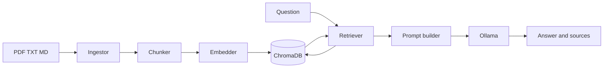

# RAG Demo

This is a modular, local Python **Retrieval-Augmented Generation (RAG)** demo. An ingestor reads PDF/TXT/Markdown; a chunker splits text; a Sentence Transformers embedder turns text into vectors; ChromaDB stores and searches vectors; a prompt builder grounds the question; local Ollama generates the answer.

## Architecture



## Run using Docker Compose

```bash
git clone https://github.com/s7rosine/rag-demo.git
cd rag-demo
docker compose up --build -d
docker compose exec ollama ollama pull llama3.2:1b
docker compose ps
```

Open http://localhost:8501 and upload `data/sample.txt`. Ask **What are the indexing steps in RAG?**. API docs: http://localhost:8000/docs. Model and embedding downloads need internet access, sufficient disk space and memory.

To stop without deleting your indexed documents: `docker compose down`.

## Run without Docker

Install Python 3.11+ and Ollama. Start Ollama and pull `llama3.2:1b` with `ollama pull llama3.2:1b`.

```bash
python -m venv .venv
source .venv/bin/activate
pip install -r requirements.txt
uvicorn api:app --host 127.0.0.1 --port 8000
```

On Windows PowerShell use `.venv\Scripts\Activate.ps1` instead of `source`. In another terminal run `streamlit run app.py`.

## Unit tests

```bash
pip install -r requirements-dev.txt
ruff check src api.py app.py tests
pytest -q
```

## Notes

This is a learning demo, **not production-ready**: no authentication or per-user isolation. Use only non-sensitive files. Uploading a document with the same filename replaces the previous document's chunks. The `/health` endpoint checks that the API process responds, not Ollama readiness. Source filenames are returned with the answer but do not guarantee factual accuracy.

## Documentation

- [SRE Operations Runbook](docs/RAG_OPERATIONS_RUNBOOK.md)
- [Architecture](docs/ARCHITECTURE.md)
- [Troubleshooting](docs/TROUBLESHOOTING.md)
