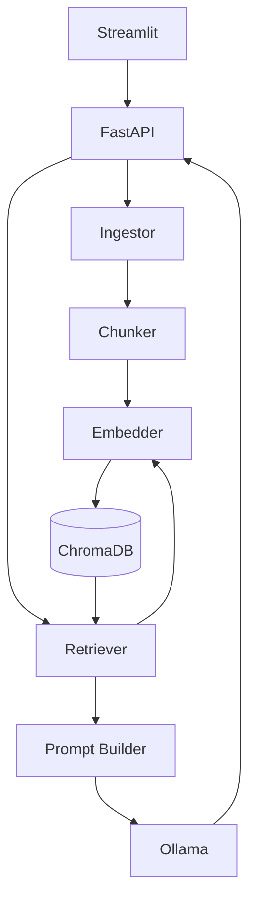

# System Architecture

**Indexing:** Documents -> `ingestor.py` -> `chunker.py` -> `embedder.py` -> `vector_store.py` (persistent ChromaDB).

**Question answering:** User question -> `retriever.py` (embeds query and searches ChromaDB) -> `prompt_builder.py` -> `generator.py` (Ollama) -> answer and source references.

`rag_pipeline.py` orchestrates both workflows. Uploaded text and embeddings are persisted in a Docker volume when using Compose. The model runs locally in the Ollama container. Ports 8000 and 8501 are bound to loopback on the host. No cloud service, role-based access, authentication or continuous metrics collection is implemented.
